<p align="center">
  
</p>

<h1 align="center">7CAST</h1>

<p align="center">
  <strong>منصة البث الذكي متعددة الوجهات ومحرر طبقات الشعارات الحي المباشر</strong><br>
  <em>Intelligent Multi-Stream Hub, Live Multi-Layer Logo Engine & Transcoder</em>
</p>

<p align="center">
  <a href="https://github.com/dev7seen/7cast/stargazers"></a>
  <a href="https://github.com/dev7seen/7cast/network/members"></a>
  <a href="https://github.com/dev7seen/7cast/blob/main/LICENSE"></a>
  <a href="https://nodejs.org"></a>
  <a href="https://ffmpeg.org"></a>
</p>

---

## تثبيت اللوحة بسطر واحد على أي سيرفر VPS

يمكنك تثبيت منصة **7CAST** بالكامل مع جميع تبعاتها (Node.js 20 LTS, FFmpeg, PM2, Firewall) وتشغيلها كخدمة ذاتية التشغيل على أي سيرفر يعمل بنظام **Ubuntu / Debian / CentOS / AlmaLinux** عبر تنفيذ سطر واحد فقط كـ `root`:

```bash
curl -fsSL https://raw.githubusercontent.com/dev7seen/7cast/main/install.sh | sudo bash
```

بعد انتهاء السكربت، ستظهر لك رسالة نجاح تحتوي على رابط اللوحة:
```text
http://YOUR_SERVER_IP:7878
```

> **ملاحظة أمان عند أول تشغيل:**
> عند فتح الرابط لأول مرة، ستطلب منك اللوحة تعيين كلمة سر رئيسية خاصة بالمسؤول (Master Admin Password) لتأمين النظام وتوليد مفاتيح تشفير الجلسات (JWT).

---

## أبرز مميزات المنصة

### 1. محرر طبقات الشعارات التفاعلي (Multi-Logo Overlay)
- **دعم طبقات غير محدودة:** إضافة أكثر من شعار فوق البث المباشر في آنٍ واحد مع التحكم المستقل بكل طبقة.
- **تطبيق فوري مباشر دون انقطاع:** إمكانية تعديل الشعار أو تغيير حجمه أو موضعه أو استبداله أثناء البث المباشر الفعلي دون أن ينقطع البث لدى المشاهدين.
- **سحب وإفلات وتغيير الحجم باللمس أو الماوس:** محاذاة تلقائية بشبكة 3×3، سحب مباشر، وتكبير/تصغير بمقابض الزوايا أو عجلة الماوس.
- **دعم كامل للهواتف الذكية:** إمكانية تحرير وتعديل أماكن وأحجام الشعارات عبر شاشات اللمس في الهواتف.
- **سحب لقطة حية من البث:** التقاط فريم حي بدقة 1080p من البث الجاري لاستخدامه كمرجع بصري دقيق لتحديد مكان الشعار.

### 2. محرك إعادة البث متعدد الوجهات (Multi-Destination Hub)
- إعادة توزيع البث إلى عدة منصات في نفس اللحظة عبر بروتوكولات **RTMP** و **RTMPS** (مثل Telegram Live, OK.ru, YouTube Live, Facebook, Twitch, Kick, والكاست المخصص).
- تفعيل وتعطيل الوجهات بشكل فردي وفوري.

### 3. تقنية الترميز الذكي (Smart Transcoding & Passthrough)
- **Direct Stream Copy (0% CPU):** إذا كان المصدر متوافقاً مع المنصات، يتم نسخ الفيديو والصوت مباشرة دون إعادة ترميز، مما يتيح تشغيل عشرات القنوات دون استهلاك موارد المعالج.
- **Auto Smart Transcoding:** تحويل تلقائي لكوديك H.264 و AAC فقط عند الحاجة لتطبيق علامات مائية أو شعارات مخصصة.
- ضبط الدقة، معدل البت (Bitrate)، معدل الإطارات (FPS)، والـ Presets لكل قناة على حدة.

### 4. نظام العلامة المائية والنص العائم الذكي
- نص مائي متحرك يطفو بسلاسة فوق الفيديو دون خلفية مشوهة.
- إمكانية رفع خطوط مخصصة (TTF / OTF) عبر لوحة التحكم وتطبيقها فوراً.
- أنماط توقيت مرنة: عرض دائم، أو دوري (يظهر لمدة محددة ثم يختفي ويتكرر).
- تأثيرات الظهور والاختفاء الناعم (Smooth Fade In / Fade Out).

### 5. واجهة احترافية متكاملة (Obsidian Dark-Tech)
- **خالية تماماً من الإيموجي:** استخدام أيقونات فيكتور هندسية حادة (Clean Inline SVGs) تعكس طابعاً احترافياً فائق الدقة.
- **شريط جانبي مختصر للهواتف (Mobile Off-Canvas Drawer):** سهولة التنقل، اختصار سريع لإنشاء القنوات، ومتابعة فورية لاستهلاك الموارد.
- **مراقبة حية للموارد عبر WebSocket:** متابعة مباشرة لمعدل الإطارات (FPS)، البت ريت الحي، سرعة البث، استهلاك المعالج (CPU)، الذاكرة العشوائية (RAM)، ووقت عمل السيرفر (Uptime).
- **طرفية سجلات حية (Live Terminal Logs):** عرض لحظي لمخرجات FFmpeg وتشخيص الاتصالات وإعادة الاتصال التلقائي عند انقطاع المصدر.

---

## متطلبات التشغيل (System Requirements)

- **نظام التشغيل:** Ubuntu 20.04+, Debian 11+, CentOS 8+, AlmaLinux 8+, Rocky Linux 8+
- **المعالج:** نواة واحدة كحد أدنى (يوصى بنواتين أو أكثر للقنوات التي تتطلب فلاتر شعارات)
- **الذاكرة العشوائية (RAM):** 1 جيجابايت كحد أدنى (يوصى بـ 2 جيجابايت+)
- **المساحة التخزينية:** 10 جيجابايت مساحة حرة
- **البرمجيات:** Node.js 20 LTS, FFmpeg 4.4+, PM2

---

## التثبيت اليدوي (Manual Installation)

في حال كنت تفضل التثبيت اليدوي خطوة بخطوة:

```bash
# 1. تحديث النظام وتثبيت التبعات الأساسية
sudo apt update && sudo apt install -y curl git ffmpeg

# 2. تثبيت Node.js 20 LTS و PM2
curl -fsSL https://deb.nodesource.com/setup_20.x | sudo -E bash -
sudo apt install -y nodejs
sudo npm install -g pm2

# 3. استنساخ المستودع
git clone https://github.com/dev7seen/7cast.git /opt/7cast
cd /opt/7cast

# 4. تثبيت حزم المشروع
npm install --omit=dev

# 5. تشغيل اللوحة كخدمة دائمة عبر PM2
pm2 start server.js --name 7cast
pm2 startup
pm2 save

# 6. فتح المنفذ في جدار الحماية
sudo ufw allow 7878/tcp
```

---

## إدارة المنصة وأوامر التحكم

```bash
# عرض السجلات الحية للبث والخادم
pm2 logs 7cast

# إعادة تشغيل المنصة
pm2 restart 7cast

# إيقاف المنصة
pm2 stop 7cast

# تحديث المنصة لآخر إصدار
cd /opt/7cast
git pull
npm install --omit=dev
pm2 restart 7cast
```

---

## هيكلة المشروع (Architecture)

```text
7cast/
├── server.js               # خادم Express الرئيسي ومحرك WebSocket
├── config.json             # ملف التكوين العام والمصادقة
├── install.sh              # سكربت التثبيت التلقائي السريع على السيرفرات
├── src/
│   ├── streamManager.js    # إدارة عمليات FFmpeg والبث المباشر وربط طبقات الشعارات
│   ├── auth.js             # محرك الأمان، JWT، وإعداد كلمة سر المسؤول لأول مرة
│   └── systemMetrics.js    # جلب إحصائيات المعالج والذاكرة والنظام في الوقت الحقيقي
├── public/
│   ├── index.html          # لوحة التحكم الرئيسية والدرج الجانبي للهواتف
│   ├── login.html          # واجهة الدخول وإعداد كلمة السر الرئيسية لأول مرة
│   ├── css/
│   │   └── style.css       # نظام الأنماط الداكن والتصميم المتجاوب
│   ├── js/
│   │   ├── app.js          # المحرك البرمجي للواجهة، طبقات الشعارات، واللمس
│   │   └── player.js       # مشغل الفيديو للمعاينة المباشرة
│   ├── assets/             # شعارات 7CAST الرسمية وفريمات المعاينة
│   └── fonts/              # خطوط العلامات المائية العربية والإنجليزية
└── data/
    └── channels.json       # قاعدة بيانات قنوات البث ومخارجها
```

---

## الترخيص والمطور (License)

تم بناء وتطوير المشروع بواسطة **[@dev7seen](https://github.com/dev7seen)** تحت رخصة **MIT License**.
متاح ومجاني للاستخدام الشخصي والتجاري المفتوح.
